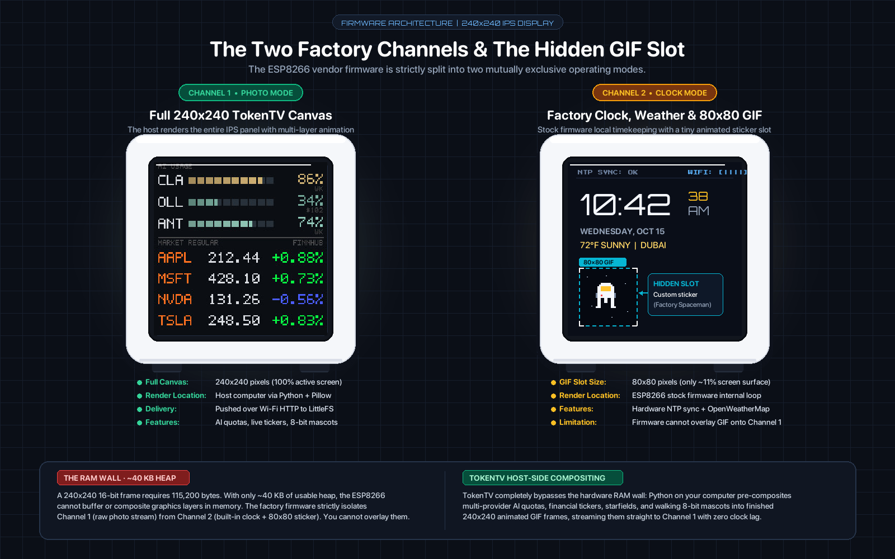
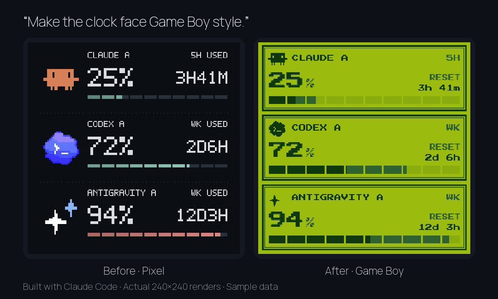

<h1 align="center">TokenTV</h1>

Your Claude, Ollama and Antigravity usage limits plus follow-the-sun global stock watchlists (US & India) on a ~$5 Wi-Fi desk clock. No firmware flashing.  
**Try it:** [live demo](https://token-tv.vercel.app) or `npx github:click6067-ship-it/token-tv demo`, no clock or login needed.  
**Set it up:** give this repo to your AI and say *"Set up TokenTV for me."* It follows [AGENTS.md](AGENTS.md).  
**Make your own face:** no clock needed, start from the [Game Boy example](examples/gameboy) and ask your AI to change it. [Guide](docs/clock-faces.md) · [Share it](https://github.com/click6067-ship-it/token-tv/issues/new?template=share_a_face.md)  
Details: [how it works](docs/stock-photo-display.md) · [setup](docs/setup.md) · [compatible clocks](docs/hardware-compatibility.md) · [Apple Watch](docs/apple-watch.md) · [architecture](docs/architecture.md) · [project page](https://tokentv.pages.dev) · [changelog](CHANGELOG.md) · MIT · [한국어](README.ko.md)  
Featured on [Hackaday](https://hackaday.com/2026/10/06/smalltv-hacking-with-surprisingly-little-fuss/).

## How it works: The Two Factory Channels & The Memory Wall

The clock's factory firmware divides its visual capability into two distinct operational "channels":

  

- **Channel 1 (Photo Mode — what TokenTV uses)**: The host computer renders a full-screen, high-res 240×240 image or multi-frame animated GIF with AI quotas, follow-the-sun watchlist telemetry (US & Indian markets), pixel mascots, and glowing gauges, uploading it via HTTP.
- **Channel 2 (Clock / Weather Mode)**: Built-in NTP digital clock and OpenWeatherMap temperature with a small 80×80 animated GIF sticker slot in the corner (the factory floating astronaut).
- **The Hidden Custom GIF Slot**: The factory astronaut in Channel 2 can be replaced with custom 80×80 GIFs.
- **The ~40 KB Memory Wall**: The clock's ESP8266 chip has only ~40–50 KB of usable RAM (a full 240×240 16-bit framebuffer requires 115 KB). Because it cannot composite layers, it can only run **Channel 1** OR **Channel 2**.
- **Host-Side Compositing**: TokenTV overcomes this hardware wall by pre-compositing animated walking mascots, starfields, gauges, and live market quotes into a single animated GIF on the host, playing smoothly on Channel 1 without touching the firmware.

