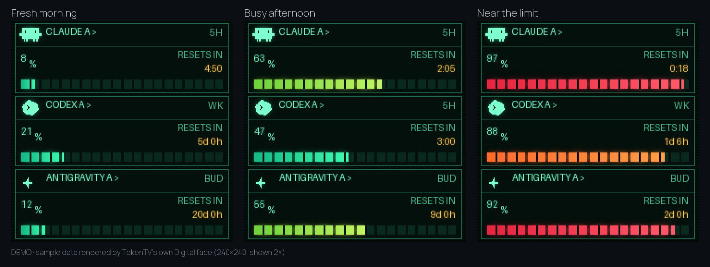
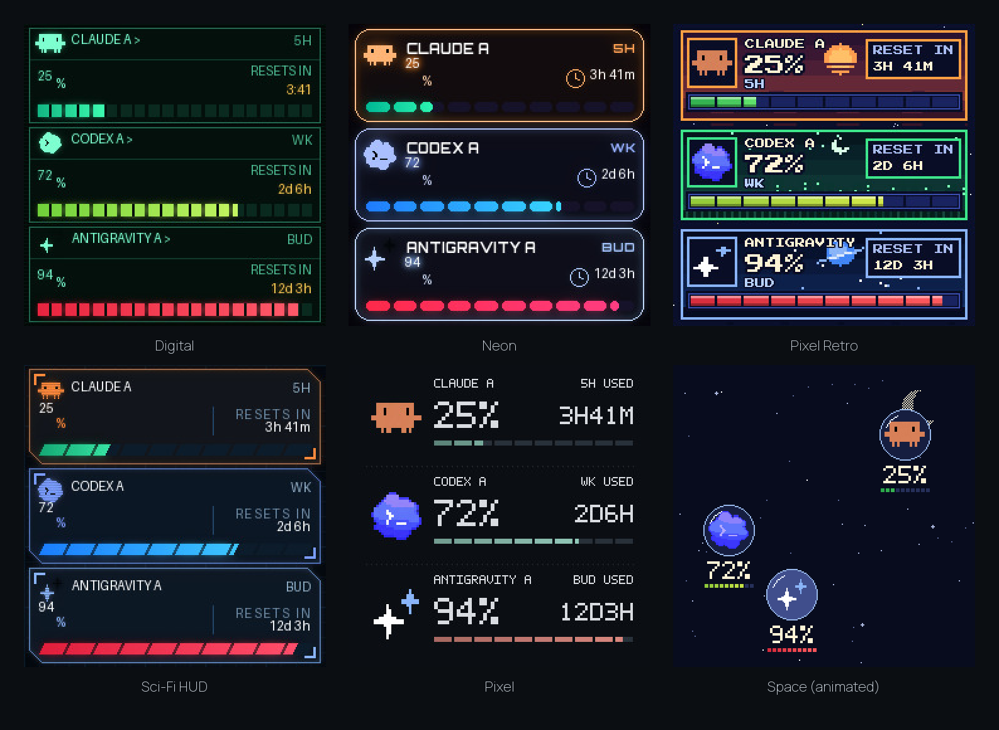

# TokenTV setup and reference

Everything that used to be in the README. Written for people and for AI coding agents; see also [AGENTS.md](../AGENTS.md).

## Quick start

Needs Python 3.10+ and the official CLI (`claude` or `agy`) for the CLI providers you use. Ollama Cloud needs only an API key.

```bash
pipx install git+https://github.com/click6067-ship-it/token-tv   # or: pip install --user git+...
token-tv demo                                     # every clock face with sample data, no login
token-tv setup                                    # asks for emails (up to 3 per provider) and the clock IP
token-tv doctor --live                            # asks each provider now; says what is missing and the fix
token-tv run                                      # dashboard at http://127.0.0.1:8787, drives the clock
```

`uvx --from git+https://github.com/click6067-ship-it/token-tv token-tv demo` runs it without installing.
TokenTV is not on PyPI yet, so plain `uvx token-tv` does not work. From a clone, `pip install .`
gives the same `token-tv` command.

<p align="center"></p>

<details>
<summary><b>All six clock faces</b></summary>

<br>



Pick one under **Clock display** in the dashboard, then press **Apply to clock**. Space is an animated
GIF that the stock photo album plays. A picture is uploaded again only when the rendered image differs
from the last upload, for example a new percentage or the Space animation that changes every 30 minutes.
</details>

## Make it yours

**Start with a working face.** No clock, login or fork needed: run the
[Game Boy example](../examples/gameboy) and ask your AI to change it. A face is one Python function
that draws 240×240 pixels; [docs/clock-faces.md](clock-faces.md) walks through it with sample data.
Copying the example or forking does not register it: after you add it to `RENDERERS` and
`STYLES` as the guide shows, it appears in the dashboard's **Gallery** as *Local*. Keep your
copy locally, or fork if you want your version on GitHub.

Want others to use it? Open a normal pull request and copy in the
[New clock face checklist](../.github/PULL_REQUEST_TEMPLATE/theme.md). Shared faces appear in the
**Gallery** for everyone on the next release, sorted by **Popular** (👍 on each theme's GitHub issue)
or **New**. Likes are counted by hand before releases, so the list says when they were counted.

<details>
<summary><b>Hardware</b></summary>

- A GeekMagic **SmallTV**-style 240×240 Wi-Fi clock whose stock firmware has a photo album page.
  The author's receipt shows ₩5,650 (a Korean AliExpress discount); prices vary by region.
  No other device has been checked.
- Any always-on machine on the same network with Python 3.10+ and the official CLIs you use.

The stock photo API (`/theme/list`, `/photo/list`, `/photo/upload`) is verified on the author's
clock. Clones with other firmware are untested.
See [docs/hardware-compatibility.md](hardware-compatibility.md) for what is verified and how to check your clock.
</details>

<details>
<summary><b>How usage is read</b></summary>

| Provider | Source | The number means |
|---|---|---|
| Claude | Claude Code CLI's own OAuth login (profile and usage) | Share of the 5-hour and weekly limits **used** |
| Ollama | Ollama Cloud `GET /api/usage?range=30d` with an API key, plus `POST /api/me` for the plan and account age | Spend in the current monthly credit period (from your account's creation day) against the monthly credit budget from your plan (or `ollama_allowance_usd`) |
| Antigravity | Antigravity CLI's `agy -p "/usage"` command (Gemini Flash and Pro) | Share of the Gemini 5-hour and weekly limits **used** |

Every login is checked against the email you configured. An Ollama account is checked against the
email on its Ollama Cloud profile (`POST /api/me`) when you configure one and the profile can be
read; it stays unverified when the account has no email configured or its profile cannot be read.
Antigravity reports no email, so its row is always marked unverified. The clock gets only a picture,
never a password, token or cookie. Polling runs every five minutes; old readings say OLD and
missing data shows a dash, never a fake 0%. Claude accounts with `refresh_with_cli: true` may
refresh an expired login through the CLI, which sends one tiny prompt.

**5-hour or weekly?** Both windows are read. The clock shows whichever is more used, with that
window's reset time. The web dashboard shows the same window first; open the other windows
under it to see the rest.

**Other screens (HYTE, Apple Watch)?** There is a browser dashboard,
but its layout on a HYTE Y70 display has not been tested. There is no Apple Watch app.
</details>

<details>
<summary><b>Accounts, clock and restore</b></summary>

- `setup` lets account A reuse the login you already have (`~/.claude`, `~/Library/Application Support/Antigravity`)
  and gives accounts B and C their own login folder under `~/.config/token-tv/homes/`.
  Non-interactive: repeat the flag, e.g. `token-tv setup --yes --ollama-email a@x.com --ollama-email b@x.com`;
  add `--isolate` to give account A its own folder too.
- Ollama Cloud has no CLI login: set `OLLAMA_API_KEY` (or store it in the macOS Keychain as
  `token-tv-ollama`) and never put the key in the config. The budget comes from the plan that
  `POST /api/me` reports: free = 0, pro = $60, max = $300, team = $1000 of monthly credits. The
  budget is monthly and can be spent at any pace. Dollars are read over `?range=30d`, and the
  reading is the current credit period's spend — from the day your account was created — against
  the full monthly budget, not a rolling 7-day or weekly quota. Set `ollama_allowance_usd` to
  override the budget.
- `token-tv connect --account claude_b` logs a separate account in with its official CLI. It
  will not log in again over your everyday `~/.claude` login unless you type REPLACE.
- `token-tv doctor` only checks that login files exist. `doctor --live` runs the same check
  as the dashboard: it asks each provider for usage, may let the CLI refresh an expired login,
  and prints only a status per account, never a token.
- The config lives at `~/.config/token-tv/config.json`. `setup` never overwrites one, and
  every command takes `--config` for another path.
- The config holds aliases, emails and CLI home paths only. Never put passwords, API keys or
  tokens in it.
- Add `"device_url": "http://<clock-ip>"` to drive the clock.
- Optional keys that bound how often the clock's flash is rewritten. All have defaults, so a
  config that omits them behaves sensibly; see [the flash-wear notes](clock-firmware.md) for the
  measurements behind them.

  | Key | Default | What it does |
  | --- | --- | --- |
  | `countdown_seconds` | `900` | Rounds the displayed countdown up to whole buckets, so it changes on a bucket edge rather than every minute. |
  | `max_writes_per_hour` | `6` | Spaces uploads. A reading that actually changed is never deferred; only a ticking countdown waits. `0` means no cap. |
  | `reassert_cycles` | `12` | How often to re-select the photo theme, so a clock that rebooted goes back to showing TokenTV. |
  | `brightness` | *(unset)* | Panel brightness, 2–99. Applied at startup, and only if it differs. |
  | `night` | *(unset)* | `{enabled, start, stop, brightness}` — the clock's own night-dimming window. |
  | `device_mac` | *(unset)* | Refuse to publish unless the clock at `device_url` reports this MAC. |

  `brightness`, `night` and the clock's other settings are stored in its EEPROM: one 4 KB sector,
  rewritten whole on every change, with no wear levelling, and it holds the Wi-Fi credentials too.
  TokenTV reads before writing and only sends what differs. Do not drive these from changing data.

  `stocks.json` takes `max_writes_per_hour` and `reassert_cycles` too, but its write budget
  defaults to `0`: a cap also throttles how fast the ticker refreshes. Each refresh uploads
  `tokentv.jpg` plus its identical `tokentv-b.jpg` twin (which is what keeps the panel re-reading
  itself under the clock's slideshow) — the stock slots are two of the three album frames the live
  publisher alternates: stocks 20 seconds, then a usage-only screen on `tokentv-usage.jpg` for 10,
  while a market is open. The stocks style runs that loop with animated frames instead: a
  four-phase breathing-arrows GIF in `tokentv.gif`/`tokentv-b.gif` (one ~2.8 s phase per panel
  repaint) and a shimmering-gauges usage GIF on `tokentv-usage.gif`. An uncapped 30-second open-market poll spends about 240 album uploads an
  hour; a budget of `6` spaces refreshes to twelve uploads an hour.

### Stock watchlist & Follow-the-Sun markets

`token-tv stocks` monitors stock tickers and publishes a 240×240 watchlist face (or feeds the combo face). It features follow-the-sun multi-market routing:
- **US Equities**: Polled from Finnhub (requires free API key via Keychain service `token-tv-finnhub` or `FINNHUB_API_KEY`). Active during regular US hours (09:30–16:00 ET / 13:30–20:00 UTC, Mon–Fri).
- **Indian Equities (NSE/BSE)**: Polled from Yahoo Finance's public v8 chart API (zero-config, no API key or registration required). Active during regular Indian hours (09:15–15:30 IST / 03:45–10:00 UTC, Mon–Fri).
- **Off-hours gap**: When neither market is open, the runner enters off-hours mode, allowing combo faces to display full-size AI usage.
- **Movers mode data sources**: the US board reads Yahoo's crumb-free predefined screens (`day_gainers`/`day_losers`), falling back to a single guarded custom screener POST; India ranks from the custom POST with client-side threshold checks. A flaked or degraded query never reaches the board: it gets one fresh-crumb retry, then the previous board is kept and the poll backs off.

Config keys in `stocks.json`:
- `"symbols"`: List of US tickers (defaults to `["AAPL", "MSFT", "NVDA", "TSLA"]`).
- `"symbols_in"`: List of Indian tickers or indices (defaults to `["RELIANCE.NS", "TCS.NS", "INFY.NS", "HDFCBANK.NS"]`). Indices like `^NSEI` and `^BSESN` automatically display as `NIFTY` and `SENSEX`. Exchange suffixes (`.NS`, `.BO`) are automatically trimmed on screen.
- `"interval"`: Refresh interval in seconds while a market is open (default 30s).
- `"mode"`: `"watchlist"` (default, the tickers above) or `"movers"`, a whole-market board of the top gainers and losers of the active market, ranked from Yahoo's screener with no API key.
- `"movers_count"`: Top gainers **and** losers per board in movers mode (default 2, so four rows fill the four-row face).

The runner re-reads this file every cycle: editing the tickers, mode, movers count or interval takes
effect the next refresh (the dashboard's clock panel can make those same edits for you). A broken
edit is ignored with a warning, keeping the last-good config.

### Both faces on one clock

To put AI usage and the watchlist on a single clock, make the stock runner a feeder and let the
usage runner own the device:

1. Remove `device_url` from `stocks.json`. The runner then only writes its snapshot, and never
   contacts a clock. Two publishers pointed at one clock fight over the same filename and over
   which saved original is authoritative, so exactly one process must own the device.
2. In `config.json`, add `"stocks_snapshot": "~/.config/token-tv/state-stocks/snapshot.json"` and
   set `"display_style": "combo"` (or animated combo styles: `combo_pulse`, `combo_cyber`, `combo_twinkle`, `combo_patrol`).
   Also point `"stocks_config"` at `stocks.json` (e.g. `~/.config/token-tv/state-stocks/stocks.json`) to let the
   dashboard's clock panel switch that face between watchlist and movers and edit its tickers.
3. Optionally set `render_seconds` (default 30). Prices move faster than `poll_seconds`, and this
   re-draws the frame without re-reading any provider.

The market section appears dynamically while an active market is open and the feed is fresh, displaying the active exchange badge (`NSE` or `US`). Outside market sessions, `combo` renders the ordinary full-size usage face.
- To give the clock back its original photo and theme, stop TokenTV and run
  `token-tv run --restore-display`.
- **macOS (untested on a real Mac):** Claude Code keeps its login in the Keychain, so TokenTV
  reads it there read-only with `security` when the CLI home has no `.credentials.json`.
  The login is still checked against the configured email. Antigravity reads its login from the
  Keychain too and reports no email, so it is never email-checked. Ollama reads its key from the
  environment or Keychain; when you configure an email for the account it is checked against the
  account profile, and it stays unverified when no email is configured or the profile cannot be read.
</details>

<details>
<summary><b>Status and contributing</b></summary>

Early and built for one desk: setup is `token-tv setup` plus CLI logins, it is tested on Linux with
one clock, and it supports Claude, Ollama and Antigravity. A new provider touches several files; see
[adding a provider](adding-a-provider.md). Issues and pull requests for providers, clock models and faces are welcome;
see [CONTRIBUTING.md](../CONTRIBUTING.md) and [making a clock face](clock-faces.md).
</details>

<details>
<summary><b>Development</b></summary>

```bash
pip install -e .
python3 -B -m unittest discover -s tests -v
python3 scripts/render_usage_examples.py   # docs/images/usage-examples.png
python3 scripts/render_clock_faces.py      # docs/images/clock-faces.png
python3 scripts/build_demo.py --out site   # the static live demo
```

`scripts/test_web_browser.cjs` runs the browser checks with a local Playwright Chromium.
</details>

MIT, see [LICENSE](../LICENSE). Bundled fonts keep their SIL Open Font License notices in
`token_tv/web/`. · [한국어](../README.ko.md)
